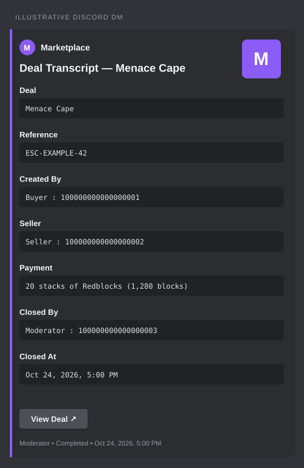

# DealBot · English edition

A Discord bot for gaming-market deals in private threads, local dispute moderation, and server-specific reputation. All built-in commands, buttons, forms, and messages are in English, including servers that previously selected Arabic. User-written messages and existing deal descriptions are preserved.

DealBot records participant confirmations. It does **not** hold, transfer, verify, or refund payments. The seller independently verifies payment before delivery; the buyer verifies receipt before completing the deal.

## Update an existing installation

1. Stop the old bot. Keep only one running process for each installation.
2. Back up the existing `data/` folder and `.env` while the bot is stopped. Keep SQLite's WAL/SHM files with the database if they exist.
3. Copy the new source files into the existing bot folder. **Keep your existing `.env` and `data/`**; the download intentionally contains neither your credentials nor your trading records.
4. Use Node.js 24 LTS, or Node.js 22.16 or newer. Run `npm ci` to install dependencies for your operating system. Do not reuse a copied `node_modules` folder.
5. Enable the Discord intents below, run `npm run commands:deploy` to refresh the server commands, then `npm start`.

Startup automatically adds missing settings, rank-role, close-approval, payment-unit, activity-log, and closure-record tables/columns. Existing profiles, deals, and settings remain. Old deals keep their literal amounts and currencies: the upgrade never guesses whether an old number meant stacks. The old `add-*-columns.js` entry points still work, but manual migrations are unnecessary. New activity events are recorded from this version onward; old events are not reconstructed.

**Version 1.2 changes the `/deal` options. Run `npm run commands:deploy` after updating**, so Discord replaces the old free-text `price` field with the new payment choices.

## Version 1.3 reputation migration

Reputation, scam flags, and staff rank changes now belong to the server where the decisions and deals occur. The profile shows **earned points** separately from an optional **staff rank override**. Overrides never create earned points; `/set-rank rank:Earned` restores the earned rank. `/review-flag` clears only the reviewed server's active flag, requires a recorded reason, and retains flag-decision history.

The upgrade keeps the old global user columns unchanged for preservation, but they no longer control eligibility or displayed reputation. Local profiles are rebuilt from completed transactions whose server and participants are known, with the same rolling 24-hour pair reward limit. Only scam decisions with attributable deal audit records are imported. Old global manual scores or unscoped flags are not silently copied into every server. Existing manually assigned ranks may therefore need an explicit local override after review. Repeated initialization does not reward deals or import decisions twice.

All original deal rows, descriptions, prices, and identities remain. Back up the database before upgrading, then run `/setup`, review `/profile`, and refresh commands with `npm run commands:deploy`.

## New installation

```sh
npm ci
```

Copy `.env.example` to `.env` and fill in:

| Variable | Purpose |
| --- | --- |
| `DISCORD_TOKEN` | Bot token from the Discord Developer Portal; needed to log in |
| `CLIENT_ID` | Application ID; needed to register commands |
| `GUILD_ID` | Your server ID; needed to register commands |
| `DATABASE_PATH` | Optional SQLite path; defaults to `data/escrow.sqlite` |

In the Discord Developer Portal, enable **Server Members Intent** and **Message Content Intent**. Message Content is required for full conversation transcripts and reading the source message for a context-menu deal. Add the bot to the server using the `bot` and `applications.commands` scopes.

Grant the bot these permissions in the chosen escrow hub:

- View Channel, Send Messages, Embed Links, Attach Files, Read Message History.
- Create Private Threads, Send Messages in Threads, Manage Threads.
- Manage Roles only if automatic cosmetic trust ranks are wanted. Keep the bot's highest role above the configured rank roles.

Participants need View Channel, Read Message History, and Send Messages in Threads in the hub. The configured staff role needs those permissions plus Manage Threads so it can see private disputes. Manage Threads can be granted through the channel's permission overrides. Do not give the bot Administrator merely for setup.

```sh
npm run commands:deploy
npm start
```

As a server administrator, run `/set-hub-channel` and `/set-mod-role`. Optionally map cosmetic roles using `/set-rank-role`. A dispute cannot be opened until a staff role with effective access to the conversation is configured.

## Commands

| Command | Use |
| --- | --- |
| `/deal seller item payment amount unit` | Choose one listed payment method and enter the total agreed payment |
| Message → Apps → Request a Deal | Choose a payment method privately, then enter the amount; the listing supplies the seller and item |
| `/deals status page` | Privately list your active or all deals in the current server |
| `/deal-status reference` | Privately inspect a reference or numeric deal ID and recent activity |
| `/profile user` | Show earned points, staff rank overrides, local flags, and deal history in this server |
| `/help` | Explain the workflow and available commands |
| `/ping` | Check the bot's response latency |
| `/set-hub-channel channel` | Administrator: choose and check the private-thread hub |
| `/set-mod-role role` | Administrator: choose the dispute-resolution staff role |
| `/set-rank-role rank role` | Administrator: map a cosmetic trust rank to a Discord role |
| `/set-rank user rank` | Administrator: set a local rank override or choose Earned to clear it |
| `/setup` | Administrator: inspect required hub/staff permissions and optional role configuration |
| `/stats` | Administrator: privately inspect this server's 30-day request cohort and current active count |
| `/review-flag user reason` | Administrator: clear a reviewed local scam flag while retaining its audit history |
| `/set-language language` | Administrator: retained for compatibility; English is the only choice |

Commands and deal listings are server-only. A deal's private status is visible to its participants and authorized staff in its own server.

## Buying from a market post

The easiest route is to right-click the seller's post and choose **Apps → Request a Deal**. Choose **Money**, **Golds**, **Redblocks**, or **Sky 1 Notchs** from the private menu. Enter the total payment shown in the post. For a game currency, leave the unit blank for individual items or enter `stacks` for stacks of 64. Text listings and embed-only listings are supported. Source-message access and private-thread membership are checked again when the form is submitted.

Alternatively, use `/deal`. These are four separate example offers for the same Menace Cape listing:

```text
/deal seller:@Seller item:Menace Cape payment:Money amount:2
/deal seller:@Seller item:Menace Cape payment:Golds amount:45
/deal seller:@Seller item:Menace Cape payment:Redblocks amount:20 unit:Stacks
/deal seller:@Seller item:Menace Cape payment:Sky 1 Notchs amount:20
```

Pick **one** option that the seller accepts. These listing prices are not currency exchange rates; DealBot does not convert or infer them. **Amount means the total agreed payment, not the quantity of the item being bought.** Money is in US dollars with up to two decimal places. Game payments use whole items or whole stacks. `20` with `Redblocks` and `Stacks` is shown consistently as **20 stacks of Redblocks (1,280 blocks)**; the stored amount remains 20 stacks.

## Deal workflow and recovery

1. The buyer sends a private request. The seller receives it by DM. If DMs are closed, the default request is cancelled privately. A buyer can explicitly enable `/deal public-offer:true` to allow the item and payment details to appear in the configured hub instead. Agree on that visibility before using it. Context-menu requests remain private by default.
2. The seller accepts. DealBot creates a private thread, adds both participants, and posts the payment step.
3. The buyer confirms payment was sent. The seller verifies receipt independently and confirms delivery. The buyer confirms receipt to complete the deal.
4. Each completed deal counts once in this server's history. Each participant earns 5 local points only if this pair has not already earned points together in this server during the previous 24 hours. Repeat deals can still complete; their messages state that no new points were awarded. Any mapped cosmetic rank is synchronized when possible.
5. Either participant can open a dispute with a reason. Payment/delivery/receipt confirmations pause while staff review it. Staff can complete the deal, cancel it, or flag a chosen participant as a scammer. Flagged users cannot start new deals.
6. Both participants can approve closing an ended conversation; authorized staff can force-close an ended conversation. An HTML transcript is attempted by DM to each participant when the thread archives, including automatic archives.

**Recover missing buttons:** run `/deal-status` inside the deal's original private thread to restore the controls for its persisted state. This also works after a restart or failed Discord message. Pending requests can be inspected anywhere in the same server: the buyer can cancel, and the seller can accept or cancel. Repeated actions cannot award trust twice or overwrite an incompatible status.

Each buyer can have up to 10 active deals and send one new request every 15 seconds per server. Both the active limit and cooldown are enforced in SQLite transactions, so concurrent requests and process restarts cannot bypass them. Unaccepted offers expire after 24 hours with an audit event; accepted, paid, delivered, and disputed deals are not expired by this policy. Live maintenance runs every minute, with lazy checks when offers are used. Money amounts must be positive and at most `9,999,999,999.99`, with at most two decimal places. Game payments must contain at most `9,999,999,999` individual items, including the multiplication by 64 for stacks. Item descriptions are limited to 1,000 characters.

## Transcript cards



After a deal conversation is archived, both participants receive a purple summary card with the server's icon, item, reference, buyer, seller, agreed payment, closer, and closing time. Names and IDs use clear code-block fields, similar to a ticket transcript. **View Deal** opens the original private conversation; the HTML conversation transcript is attached to the same DM. The file uses the item name, such as `transcript-menace-cape-42.html`.

The closer is recorded before an archive request and confirmed using Discord's archive timestamp. Participant approval and moderator closure retain their actual actor. Archives made outside DealBot's close controls are labeled **Automatic archive or a Discord-side action**, since the bot cannot identify that actor from a thread update alone. Failed attempts and reopened threads do not inherit the wrong closer. REST and Gateway observations of the same archive share a delivery operation, including SDK cache races.

The preview is illustrative; Discord controls the theme and attachment preview. If transcript generation fails, the summary still arrives with an explicit unavailable-file message. Closed DMs are logged independently so one recipient does not prevent the other from receiving their record.

Transcripts include up to the latest 10,000 messages. Attachments remain links and depend on Discord availability. Delivery requires the participant to accept the bot's DMs; a failed DM is logged and is not retried automatically. An auto-archive does not complete or cancel an active deal; `/deals` still shows its recorded state. Reopen the thread before using its controls.

## Multiple servers and operations

Run `/setup` as an administrator in each server for a read-only health checklist. It explains required fixes and checks optional cosmetic rank roles. `/stats` gives private aggregate counts for deals opened in that server during the last 30 days, grouped by their current status. Completion rate means completed requests divided by all requests opened in that window. The current active count spans all dates. These metrics do not mix currencies, expose personal deal details, or claim verified sales revenue.

Single-server command registration remains the default. To register commands for all servers where the application is installed, use the optional global mode with `DISCORD_TOKEN` and `CLIENT_ID` configured:

```sh
npm run commands:validate:global
npm run commands:deploy:global
```

A `GUILD_ID` is not required for global registration. Every command still requires a server context and checks local permissions. Global command propagation is managed by Discord. Existing guild-specific definitions take precedence over global definitions in that guild; refresh those with `npm run commands:deploy` as well. Development only exercised offline definitions and mocked REST routes; live global registration must be performed by the operator.

For a consistent SQLite snapshot, including committed WAL data:

```sh
npm run db:backup
# Or choose a new output file without overwriting an existing backup:
npm run db:backup -- --output /path/to/new-backup.sqlite
```

This uses SQLite's online backup API, opens the source read-only without running migrations, verifies integrity and foreign keys, and publishes a private standalone file. The default destination is a unique file in the database folder's `backups/` directory. It does not copy `.env`, upload backups, or schedule retention. To restore, stop the bot, preserve the current database and its sidecars, and point `DATABASE_PATH` at a verified backup before starting again. Keep recovery copies away from the host; a backup on the same disk alone is not disaster recovery.

See [the launch plan](docs/LAUNCH_PLAN.md) for the proposed small-community pilot, measurable adoption questions, and remaining hosting, support, privacy, and scale work. Global registration does not demonstrate global readiness.

## Development and checks

```sh
npm test
npm run check
npm run commands:validate
npm run commands:validate:global
npm run preview:transcript
npm run db:init
npm run dev
```

Tests use isolated temporary or in-memory databases and simulated Discord interactions. They do not log in, publish commands, or send messages. Coverage includes legacy migrations, scoped reputation, anti-farming rewards, audited decisions, atomic state changes, rollback, concurrent-process caps and cooldowns, privacy defaults, request expiry, permissions, setup/stats, command deployment routes, online backup/restore integrity, payment validation, transcript generation, and duplicate-delivery prevention. The check command verifies JavaScript syntax, JSON, and the absence of Arabic text in built-in source strings.

`commands:validate` serializes and validates command definitions without credentials or HTTP. Only `commands:deploy` registers them. `db:init` applies idempotent migrations. For native SQLite build tools on Linux, install Python, Make, and a C++ compiler if your Node version has no prebuilt module.

Cloud tasks already have an isolated checkout. Use the existing checkout; do not create another Git worktree for normal development. Prepared dependencies persist in a cloud snapshot, but a bot process must be started again with runtime configuration. Live Discord login, command registration, and transcript delivery require validation in your server; offline tests alone do not establish those live permissions.
